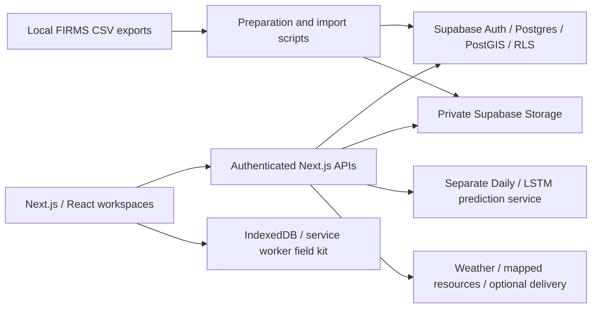

# FireCase

**Wildfire intelligence and incident coordination for Bicol, Philippines.**

FireCase is a research prototype that brings historical satellite fire observations, regional fire-activity predictions, incident records, ground verification, and recovery measurements into one role-based workspace. It explores how Earth observation data can support a shared workflow between emergency responders, firefighters, land managers, and administrators.

The prototype focuses on making evidence usable: where a satellite observation came from, which cases need a ground check, what responders have reported, and what recovery measurements are available.

[Application](https://firecase-1.onrender.com/) · [Prediction API documentation](https://firecase.onrender.com/docs) · [Actor workflows](docs/actor-workflows.md) · [Technical documentation](#documentation)

> **Project status:** Research and demonstration prototype. Historical FIRMS observations are separate from fictional incident scenarios. Records marked `DEMO` and scripted spread, risk, and burn-planning scenarios demonstrate workflows; they are not observed emergencies or validated operational forecasts.

## Review the prototype

The application and prediction API are separate services. The application hosts the user interface and operational APIs; the prediction service provides Daily and LSTM inference.

For a walkthrough without an operational account, open [`/demo`](https://firecase-1.onrender.com/demo). This preview is available when the deployment enables `FIRECASE_DEMO_MODE=true`; otherwise it returns 404.

1. Start as **Emergency Responder** and request ground confirmation for a sample case.
2. Switch to **Firefighter**, select that case, and submit a sample report.
3. Return to **Emergency Responder** to inspect the updated verification count.
4. Switch to **Land Manager** to explore recorded fire history and illustrative recovery observations.
5. In the firefighter workspace, download a case and open the offline screen to try local report drafts.

The public preview uses shared in-browser sample state. It does not submit operational records or send alerts. Signed-in features require an active account; new registrations require administrator approval. No shared credentials are published in this repository.

## What FireCase implements

| Capability | Current implementation |
|---|---|
| Historical fire observations | Imports MODIS and VIIRS CSV records, filters them to a Bicol research boundary, preserves acquisition metadata, and displays historical summaries and map markers. |
| Incident coordination | Tracks Watch, Active, Recovery, and Closed cases, with separate verification and incident-status fields. |
| Case prioritization | Sorts Watch and Active cases by a stored priority score, with deterministic tie-breaking. Scores are entered or supplied by demo records; no weighted risk-scoring model is implemented. |
| Ground verification | Provides verification requests, firefighter reports, remarks, and optional private photo attachments. |
| Regional activity prediction | Connects to Random Forest/PCA Daily and 14-day LSTM models through a separate API; validates requests and stores prediction history. |
| Land history and recovery | Displays monthly case counts, comparable-month historical summaries, and recorded vegetation-index, burned-area, severity, and recovery-status measurements. |
| Map and field tools | Supports area drawing, browser-saved views, shared monitoring areas, layer controls, external resource/weather lookups, GeoJSON overlays, and CSV/GeoJSON exports. |
| Offline field kit | Saves a selected case, access notes, and report drafts on the device. Its nine cached map tiles are schematic illustrations, not offline satellite or navigation maps. |
| Warning workflow | Supports draft, review, and optional configured delivery through Resend or an authenticated webhook. Provider acceptance is distinct from confirmed recipient delivery. |

### Roles

| Role | Main responsibilities |
|---|---|
| Admin | Approve accounts, manage access and monitoring areas, assign land managers, and review system activity. |
| Emergency Responder | Review the operational queue, create manual Watch cases, request field verification, use activity models, and prepare reviewed warnings. |
| Firefighter | Inspect accessible incidents, submit ground reports and optional photos, and prepare offline report drafts. |
| Land Manager | Review assigned areas, recorded fire history, and sourced recovery observations. |

See [actor workflows](docs/actor-workflows.md) for the interaction details and [database schema](docs/schema.md) for the underlying records and access model.

## Earth observation data and provenance

### Historical FIRMS observations

FireCase uses locally supplied exports from [NASA's Fire Information for Resource Management System (FIRMS)](https://firms.modaps.eosdis.nasa.gov/). The audited Bicol reference dataset contains:

| Field | Audited value, 15 November 2026 |
|---|---|
| Retained observations | **4,462** |
| MODIS | 247 observations; Terra and Aqua |
| VIIRS | 4,215 observations; Suomi NPP |
| Acquisition coverage | 29 November 2023, 16:31 UTC – 12 November 2026, 00:34 UTC |
| Source categories | 4,373 archive records and 89 near-real-time records, imported from CSV files |
| Geographic selection | Simplified Bicol Region administrative boundary, PH-05 |

These are historical thermal-anomaly observations, not a count of independently confirmed wildfire incidents. The application does not currently poll the live FIRMS API. Its historical map exposes the latest 500 reference markers alongside full-dataset summary counts; it does not implement temporal replay.

The preparation pipeline:

1. Checks coordinates and retains vegetation/unknown-type observations.
2. Applies point-in-polygon filtering, including polygon holes, to the Bicol boundary.
3. Normalizes acquisition timestamps to UTC.
4. Deduplicates observations by sensor, satellite, acquisition time, and coordinates; archived records take precedence over matching NRT records.
5. Preserves source filenames, original fields, product category, and confidence metadata.
6. Upserts detections and stores reference assets in private Supabase Storage.

VIIRS categorical confidence is normalized; MODIS numeric confidence remains in the original metadata. Fire Radiative Power is recorded in **megawatts**, independently of burned area in **hectares**.

The boundary is extracted from a pinned geoBoundaries gbOpen Philippines ADM1 dataset. Its provenance, boundary year, source attribution, and recorded license are documented in [the boundary reference](data/reference/README.md). It is an administrative research boundary, not an observed fire perimeter or cadastral survey.

### Model inputs and recovery data

| Dataset | Coverage and limitations |
|---|---|
| Weather reference | 1,826 daily records, 2021–2025. The source CSV does not establish Bicol-specific spatial coverage. |
| Stored model observations | 778 daily records, 15 November 2023 – 31 December 2025. These preserve the model's Philippines-wide training aggregation, including zero-filled missing daily hotspot counts. |
| Recovery observations | Stored or manually entered measurements with a source field. Existing demonstration recovery surveys are synthetic; no satellite-derived burn-scar measurements are generated by the importer. |
| Additional research assets | Rainfall and soil-moisture NetCDF files are inventoried but not ingested. The burned-area download manifest does not supply processed HDF measurements. |

Generated datasets, original downloads, credentials, and model artifacts are not bundled with this frontend repository. A fresh installation therefore needs its own authorized data preparation/import and a compatible prediction service.

## Prediction scope

The separate [FireCase prediction API](https://firecase.onrender.com/docs) provides:

- `POST /predict`: Daily Random Forest/PCA inference using weather, the current daily hotspot count, and the preceding seven-day mean.
- `POST /predict/lstm`: LSTM inference using **14 consecutive daily observations**, oldest first.
- `GET /health`: Model-readiness information.

Both models classify **next-day regional high hotspot activity**. A returned probability does not establish the probability of ignition at a selected barangay, an individual fire's location, a spread perimeter, or burned hectares. Optional location/source context is stored with the request but is not sent to models whose schemas do not accept it.

The application validates input and response structures, records a pending request, and saves its result or failure in `fire_predictions`. Stored historical inputs support retrospective evaluation, not a claim about current conditions. Use the training dataset's units and aggregation; do not substitute invented measurements or zeros for missing weather values.

The [OpenAPI snapshot](docs/firecase-openapi.json) documents the service contract. Model training and inference are maintained separately from this repository; service readiness and a successful response do not establish predictive accuracy or geographic generalization.

## Scope and limitations

The following boundaries are important when evaluating the prototype:

- **Watch creation is manual.** There is no automatic anomaly-to-Watch pipeline or operational statistical anomaly detector. The demo risk outlook and baseline are scripted.
- **Verification summaries count case flags.** They do not perform spatial/temporal matching of satellite detections to reports or independently certify ground truth.
- **Recovery charts display recorded values.** There is no imagery-based burn-scar segmentation, NDVI derivation, or regrowth forecast. Demo scar outlines are synthetic geometry.
- **Spread and burn planning require separate providers.** Built-in scenarios are illustrative; Daily/LSTM activity models do not provide spread forecasts or burn authorization.
- **Rainfall is not terrain hazard scoring.** No slope, landslide, or flood-susceptibility model is connected.
- **The local assistant uses English keyword matching.** It summarizes loaded records; it is not an LLM or a Filipino/Bikol language assistant.
- **Offline support is limited to a downloaded field kit and local drafts.** Submission requires reconnection and user action. Browser storage can be evicted.
- **Operational views can contain demo records.** Persisting a fictional record in the database does not make it a real incident; source labels must remain visible when interpreting totals.

FireCase supports research and workflow demonstrations. Decisions about emergency response, evacuation, land access, and authorized burning require responsible local authorities and independently verified information.

## Architecture



**Frontend:** Next.js 14, React 18, TypeScript, Leaflet, Recharts, Lucide, and Tailwind CSS.
**Application backend:** Next.js route handlers, Zod validation, Supabase Auth, PostgreSQL/PostGIS, and private Storage.
**External services:** Mapbox map tiles, OpenStreetMap/Overpass mapped resources, Open-Meteo weather, and optional Resend/webhook delivery.

Normal operational reads use the signed-in session and database access policies. Selected server-only operations, such as reference downloads and validated inserts, use privileged credentials after application authorization checks. See [workspace tools](docs/workspace-tools.md) for provider contracts and configuration.

## Run locally

### Prerequisites

- Node.js 20 or newer and npm.
- A Supabase project, or Supabase CLI and Docker for a local database.
- Python 3 if preparing research datasets or running the Python tests.
- A Mapbox public token for map tiles and a compatible prediction API for model inference.

### 1. Install and configure

```sh
git clone https://github.com/DanielwqwB/FireCase.git
cd FireCase
npm ci
```

Copy `.env.example` to `.env.local` and configure the required variables:

| Variable | Purpose |
|---|---|
| `NEXT_PUBLIC_SUPABASE_URL` | Supabase project URL. |
| `NEXT_PUBLIC_SUPABASE_PUBLISHABLE_KEY` | Browser-safe Supabase publishable key. |
| `SUPABASE_SECRET_KEY` | Server-only access for supported privileged operations. Never expose through a `NEXT_PUBLIC_` variable. |
| `NEXT_PUBLIC_MAPBOX_ACCESS_TOKEN` | Public map token, restricted to approved application URLs. |
| `FIRECASE_PREDICTION_API_URL` | Compatible model-service base URL; defaults to `https://firecase.onrender.com`. |
| `FIRECASE_DEMO_MODE` | Explicit opt-in for the public preview and labeled scripted scenarios; defaults to `false` in the example. |

Optional spread, burn-advisory, and alert-delivery settings are described in [`.env.example`](.env.example) and [workspace tools](docs/workspace-tools.md). Keep local environment files and server credentials out of version control.

### 2. Prepare the database

For a new local development database:

```sh
npx supabase start
npx supabase db reset
```

`db reset` recreates the local database and applies the migrations; use it only for a disposable development instance.

For a hosted project, link the intended project and apply the migrations:

```sh
npx supabase link --project-ref <your-project-ref>
npx supabase db push
```

Review pending migrations before applying them to an existing project. The migrations define operational tables, access policies, private photo storage, prediction history, registration, and first-administrator bootstrap.

### 3. Create the first administrator

Create an Auth user in Supabase. As the database owner, run:

```sql
select public.bootstrap_first_admin('<auth-user-uuid>');
```

The bootstrap function is unavailable to application API roles and requires that no active administrator already exists. After setup, an active administrator can approve registrations or invite other users. Registration does not automatically grant access.

For hosted Auth, enable email confirmation and configure the application origin and `/auth/confirm` redirect in Supabase.

### 4. Start the application

```sh
npm run dev
```

Open `http://localhost:3000`. To enable the sample walkthrough, set `FIRECASE_DEMO_MODE=true`, restart the server, and visit `/demo`. The main signed-in workspace still requires an active profile.

### Optional: import research data

Provide a source directory containing the expected FIRMS CSV exports and `FireCase_Weather_2021_2025.csv`, with the processed `FireCase_Merged_Daily_2021_2025.csv` in the sibling `processed/` directory expected by the preparation script.

```sh
python scripts/prepare-research-data.py --source /path/to/research/Data
node scripts/upload-research-data.mjs
```

The second command previews the upload. To write the prepared datasets to the configured Supabase project:

```sh
node scripts/upload-research-data.mjs --apply
```

Preparation preserves the original inputs. Uploading writes detection rows, private `research-datasets/bicol-v1/` reference assets, and synchronization logs; it does not create confirmed incidents. Generated files are excluded from Git under `.local-data/`. The source manifest records file hashes, counts, coverage, and processing exclusions.

## Validation

Run from the repository root:

```sh
node --test tests/*.test.cjs
python -m unittest discover -s tests -p "test_*.py"
npm run typecheck
npm run lint
npm run build
```

The **15 November 2026 audit** passed 44 Node tests, three Python tests, TypeScript checking, and lint. Two browser suites also passed: actor-action checks using intercepted API fixtures, and the demo-role workflow including an offline reload and draft report. These results describe that audit snapshot, not a continuous integration badge or production certification. The production build is listed as a separate check and was not rerun as part of that audit.

Browser checks require a local server and Microsoft Edge. Start a development server on port 3010, then run:

```sh
npm run dev -- --port 3010
```

In a second terminal:

```sh
npm exec --package=playwright --package=axe-core -- node tests/actor-actions.browser.cjs
npm exec --package=playwright -- node tests/role-workspaces.browser.cjs
```

Fixture and demo tests do not establish production RLS correctness, live photo uploads, model accuracy, field truth, or final alert delivery. Those require separate authorized integration and domain validation.

## Repository layout

```text
src/app/              Pages, role-aware navigation, styles, and API routes
src/components/       Operational workspaces, maps, prediction UI, and field tools
src/lib/              Data types, calculations, validation, and Supabase clients
supabase/migrations/  Database schema, functions, policies, and account setup
scripts/              Research preparation/import and explicit synthetic seeding
public/               Static assets and offline field screen/service worker
data/reference/       Bicol boundary and provenance notes
docs/                 Workflow, API-contract, schema, and usability documentation
tests/                Unit tests and browser workflow checks
```

## Documentation

- [Actor workflows and demonstration](docs/actor-workflows.md)
- [Database schema and relationships](docs/schema.md)
- [Map tools, offline scope, and provider contracts](docs/workspace-tools.md)
- [Prediction API contract snapshot](docs/firecase-openapi.json)
- [Usability review](docs/usability-audit.md)
- [Bicol boundary provenance and attribution](data/reference/README.md)

## Acknowledgments

FireCase uses [NASA FIRMS](https://firms.modaps.eosdis.nasa.gov/) MODIS and VIIRS observations as historical research inputs, a [geoBoundaries](https://www.geoboundaries.org/) administrative boundary, [OpenStreetMap](https://www.openstreetmap.org/copyright) mapped features, [Open-Meteo](https://open-meteo.com/) forecasts, and Mapbox map tiles. Dataset-specific attribution and provider terms remain applicable.

Use of NASA data does not imply NASA endorsement.
